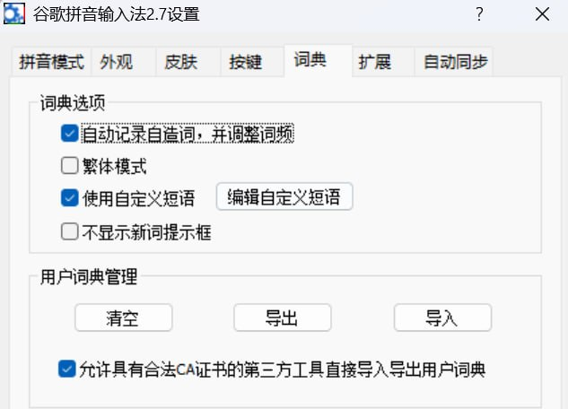

# Windows Google Pinyin dictionary

The latest public dictionary is published as a release asset:

- [Download `google-pinyin-dictionary-20261116.zip`](https://github.com/CryptoMiaobug/Google-Pinyin-Mirror/releases/tag/google-pinyin-dictionary-2026-11-16)

It contains 880,079 entries in Windows Google Pinyin text format: GBK, CRLF, no BOM, with `word<TAB>weight<TAB>space-separated pinyin` fields. It is intended for **Windows Google Pinyin**, not Gboard or Rime. Back up an existing user dictionary before importing.

在谷歌拼音设置中打开“词典”→“用户词典管理”。先点击“导出”备份现有用户词典，再点击“导入”选择下载的词库文件：

The data was derived from the Rime Ice `base` and `ext` dictionaries at commit `927e1cf1d3eeb9bf4be85e3f684dba4dd485b6f6` (source headers dated 2026-11-01). The public compatibility check removed 1,579 source keys that were absent from a supplied post-import export; no private user-export entries were included. The release archive contains the source attribution/license record. Review upstream terms before redistribution or commercial use.
