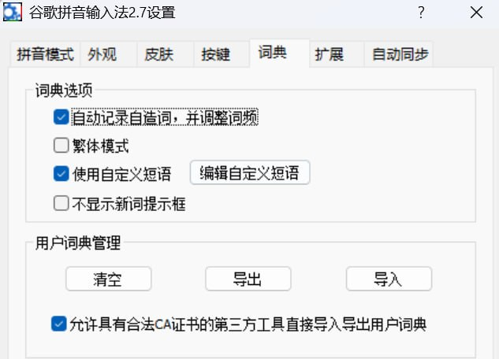

# Google-Pinyin-Mirror
A mirror for the Google Pinyin website. https://googlepinyin.com

Check our project in [GitHub](https://github.com/WordlessEcho/Google-Pinyin-Mirror).

## Dictionary

A Windows Google Pinyin dictionary derived from the Rime Ice public dictionaries is available in [DICTIONARY.md](DICTIONARY.md).

### 导入与导出

在谷歌拼音设置中打开“词典”→“用户词典管理”。建议先点击“导出”备份现有用户词典，再点击“导入”选择下载的词库文件。

